<p align="center">
  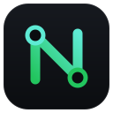
</p>

<h1 align="center">Nexo</h1>

<p align="center">
  <b>Cliente SSH · SFTP · túneles · RDP</b> con bóveda cifrada, y <b>Nexo Server</b>: un servidor de acceso
  autoalojado para que tu organización controle quién entra a qué servidor <b>sin entregar llaves</b>.
</p>

<p align="center">
  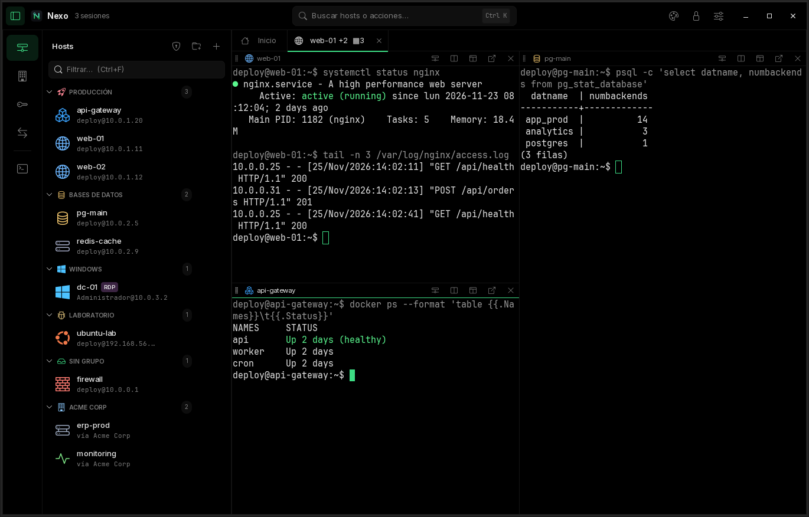
</p>

---

## Índice

1. [Qué es Nexo](#1-qué-es-nexo)
2. [Capturas](#2-capturas)
3. [Instalar la app de escritorio (paso a paso)](#3-instalar-la-app-de-escritorio-paso-a-paso)
4. [Montar Nexo Server para tu organización (paso a paso)](#4-montar-nexo-server-para-tu-organización-paso-a-paso)
5. [Cómo se conectan los usuarios](#5-cómo-se-conectan-los-usuarios)
6. [Operación diaria: bloquear, auditar, grabaciones](#6-operación-diaria-bloquear-auditar-grabaciones)
7. [Respaldos y actualizaciones](#7-respaldos-y-actualizaciones)
8. [Referencia: variables y puertos](#8-referencia-variables-y-puertos)
9. [Modelo de seguridad](#9-modelo-de-seguridad)
10. [Limitaciones conocidas](#10-limitaciones-conocidas)
11. [Licencia](#11-licencia)

---

## 1. Qué es Nexo

Nexo tiene dos piezas que puedes usar juntas o por separado:

| Pieza | Para quién | Qué hace |
|---|---|---|
| **App Nexo** (escritorio, Linux) | Cualquier persona que administra servidores | Hosts, llaves, terminal con pantalla dividida, SFTP, túneles y RDP. Todo se guarda en una bóveda local cifrada. |
| **Nexo Server** (Docker) | Organizaciones | Guarda las credenciales de los servidores y da acceso por persona o equipo, con 2FA, bloqueo inmediato, grabación de sesiones y auditoría. |

```
  App Nexo / ssh (cada persona)        Nexo Server (Docker)                         Tus servidores
  ─────────────────────────────        ─────────────────────────────────            ──────────────
  usuario + contraseña + 2FA     ──▶   API: valida y entrega un token temporal
  terminal / sftp / túnel        ──▶   Puerta SSH :2222 ── abre la sesión con  ──▶  web-01
                                         · revisa permisos   credenciales que       db-01
                                         · graba la sesión   nunca salen de aquí    erp-prod
  Administrador (navegador)      ──▶   Panel web: usuarios, hosts, permisos, bloqueo,
                                         sesiones en vivo, grabaciones y auditoría
```

**Funciones principales**

- 🔐 **Bóveda cifrada** (AES-256-GCM + scrypt) con contraseña maestra y autobloqueo.
- 🖥️ **Terminal** con pestañas y **pantalla dividida**: arrastra una pestaña al borde de otra terminal
  para ponerla al costado.
- 📁 **SFTP**: navega, sube y descarga archivos; los archivos remotos se editan con tu editor y se
  suben solos al guardar.
- 🔀 **Túneles** locales, remotos y SOCKS; **saltos** por bastión con llave o contraseña.
- 🪟 **RDP** con FreeRDP.
- 🗄️ **Bases de datos**: PostgreSQL, MySQL/MariaDB, SQL Server, MongoDB y Redis, con árbol de objetos,
  editor con resaltado, resultados en tabla, exportación a CSV, modo **solo lectura** y **túnel SSH
  automático**.
- 🔑 **Llaves SSH**: genera e importa; se cargan en un agente propio y nunca se escriben
  descifradas en disco.
- 🏢 **Organizaciones**: te conectas a un Nexo Server y ves solo lo que te asignaron.
- ⌨️ Paleta de comandos (`Ctrl+K`), grupos con iconos, 14 temas y colores de acento.

---

## 2. Capturas

### App de escritorio

| Inicio y hosts recientes | Paleta de comandos (`Ctrl+K`) |
|---|---|
| 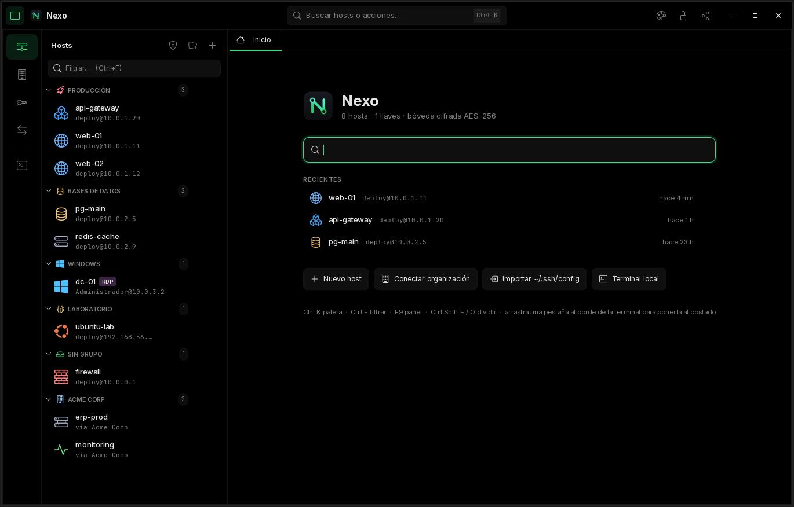 | 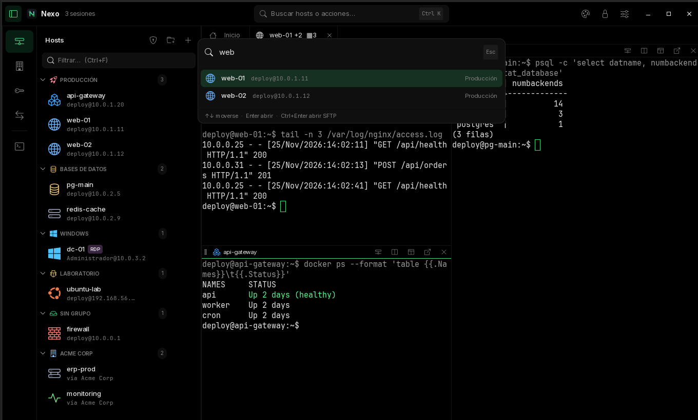 |

| Temas y colores de acento | Organizaciones (Nexo Server) |
|---|---|
| 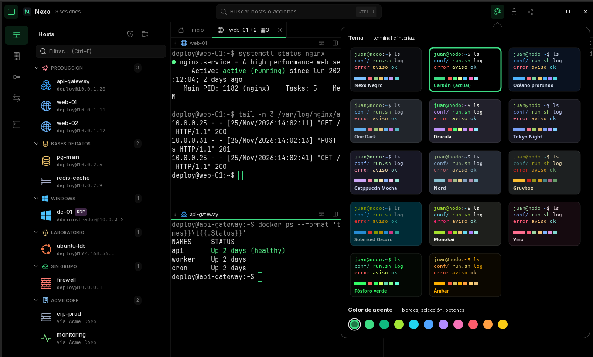 | 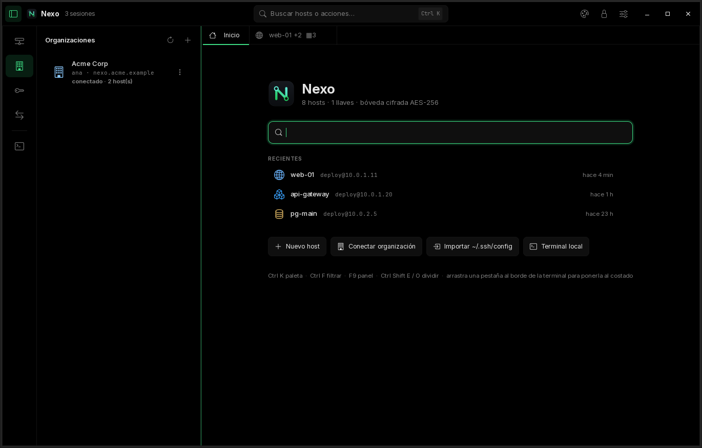 |

| Base de datos (PostgreSQL) | Base de datos (MongoDB) |
|---|---|
| 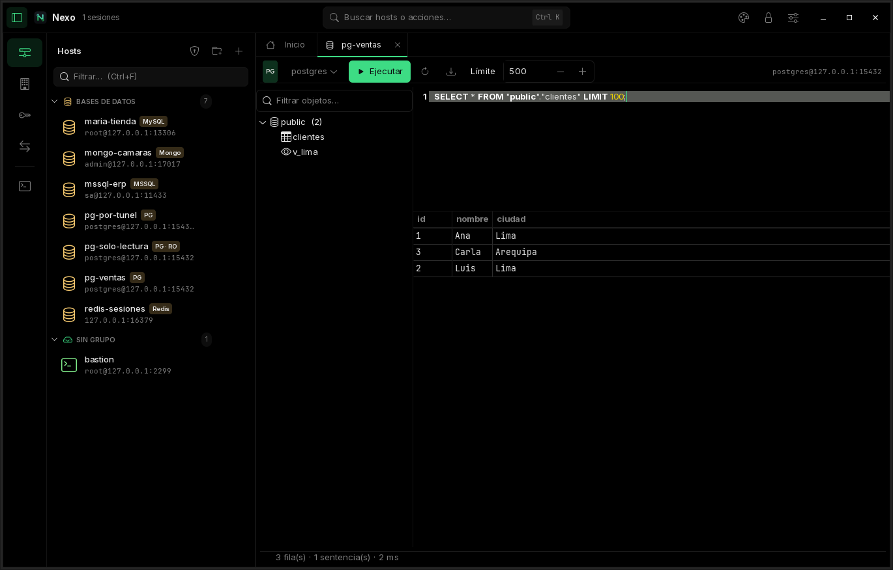 | 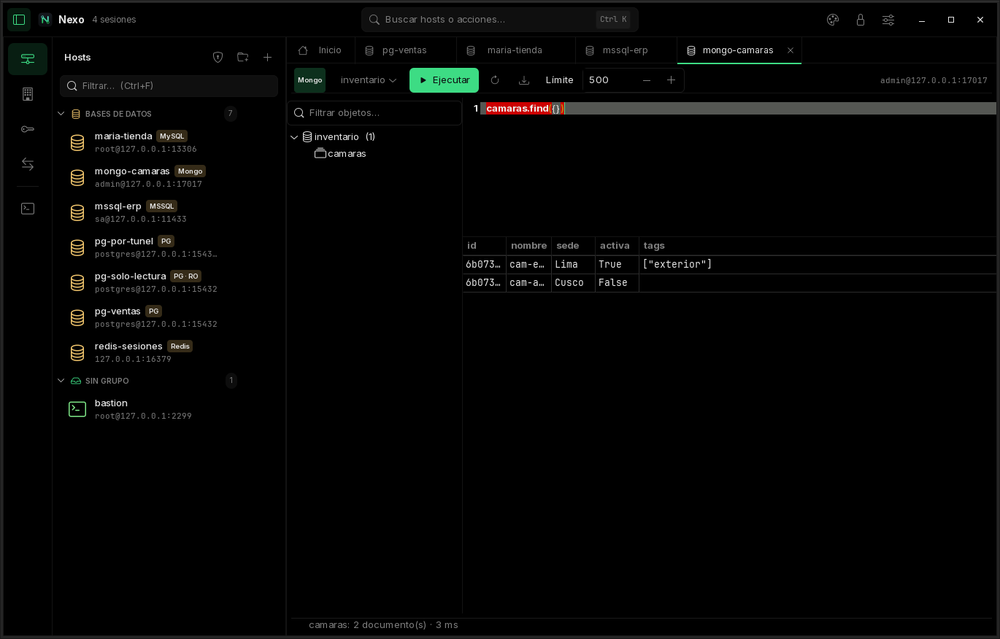 |

### Panel web de Nexo Server

| Resumen | Usuarios (bloquear con un clic) |
|---|---|
| 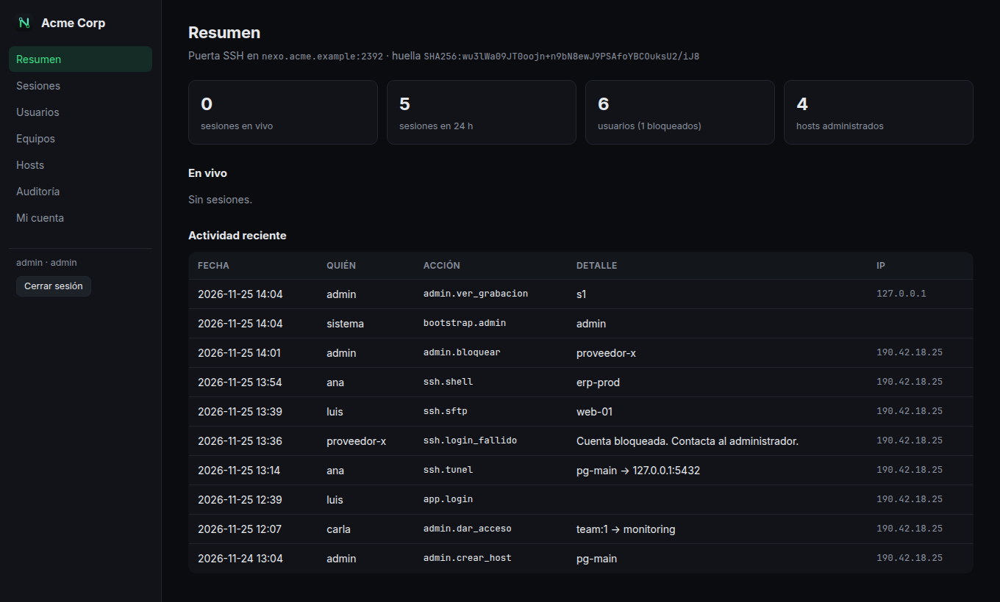 | 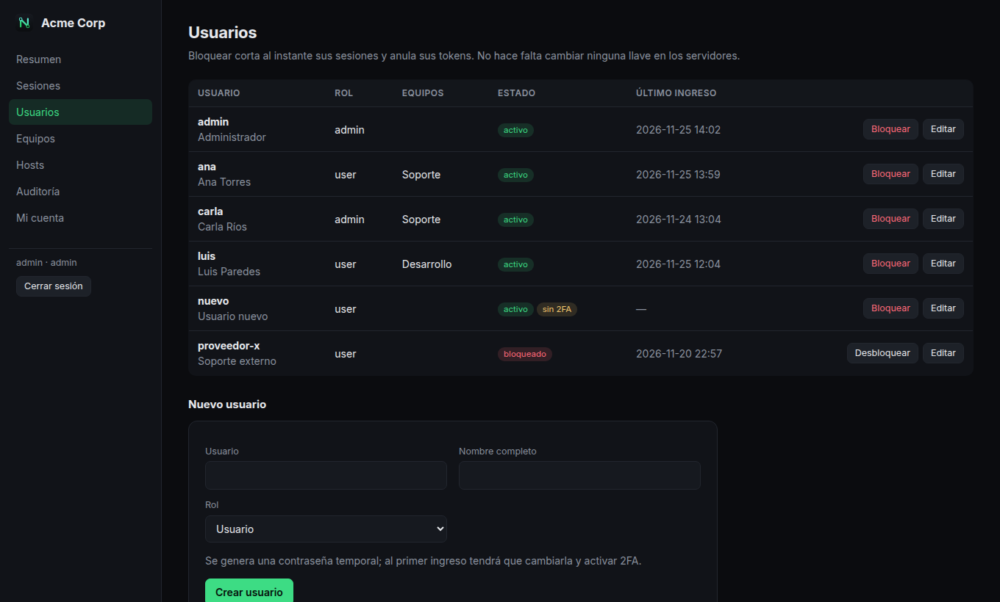 |

| Permisos por host | Grabación de una sesión |
|---|---|
| 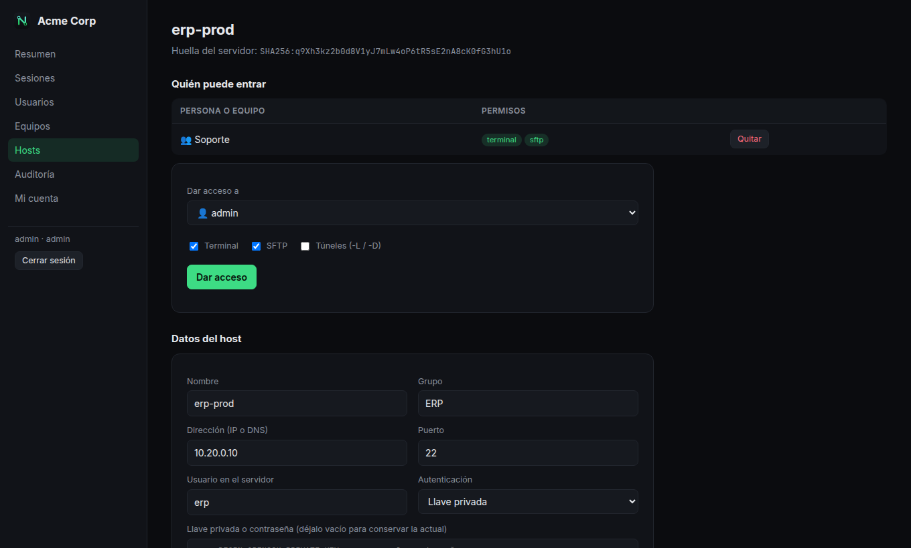 | 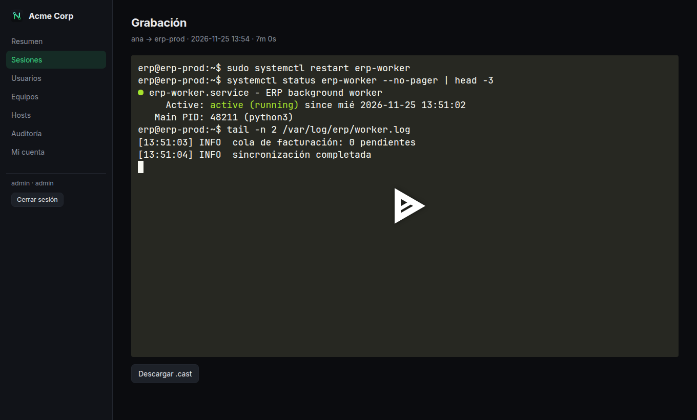 |

---

## 3. Instalar la app de escritorio (paso a paso)

> Probada en **Ubuntu 24.04 / 26.04**. Funciona en distribuciones con GTK 3 y VTE.

### Paso 1 — Descargar e instalar

**Opción A: paquete listo (recomendado)**

1. Entra a **[Releases](https://github.com/D4rksit3/nexo/releases/latest)** y descarga `nexo_<versión>_all.deb`.
2. Instálalo (apt baja solo las dependencias):

   ```bash
   sudo apt install ./nexo_*_all.deb
   ```

**Opción B: generar el paquete desde el código**

```bash
git clone https://github.com/D4rksit3/nexo.git
cd nexo
./packaging/build-deb.sh            # crea dist/nexo_<versión>_all.deb
sudo apt install ./dist/nexo_*_all.deb
```

Recomendado para todas las funciones: `sudo apt install sshpass freerdp3-x11`. `sshpass` sirve para
contraseñas y organizaciones; `freerdp3-x11`, para RDP.

### Paso 2 — Abrir Nexo y crear tu bóveda

Abre **Nexo** desde el menú de aplicaciones o escribe `nexo` en una terminal. La primera vez te pide
crear una **contraseña maestra**: cifra todo lo que guardes y **no se puede recuperar** si la olvidas.

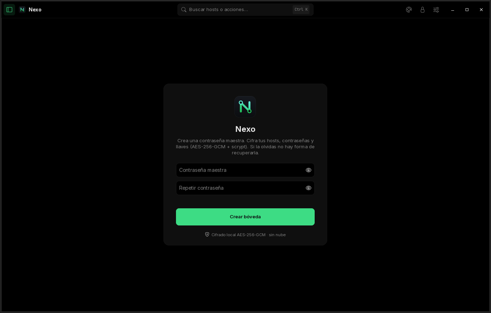

### Paso 3 — Agregar tus servidores

- **Uno por uno:** botón **+** del panel *Hosts*. Eliges protocolo (SSH o RDP), dirección, usuario,
  llave o contraseña, grupo e icono.
- **Todos de una vez:** menú de ajustes → **Importar hosts de `~/.ssh/config`**. También importa tus
  llaves.

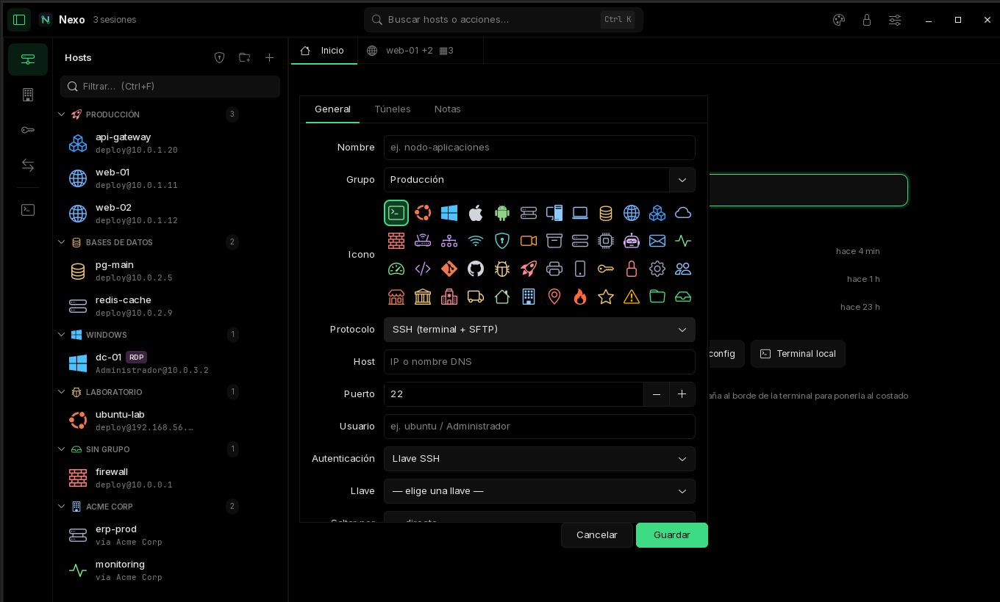

### Paso 4 — Conectar

- Haz **doble clic** en un host o usa **`Ctrl+K`** y escribe su nombre.
- **Dividir la pantalla:** arrastra una pestaña al borde izquierdo, derecho, superior o inferior de la
  terminal. También sirve `Ctrl+Shift+E` (derecha) o `Ctrl+Shift+O` (abajo).
- **SFTP:** botón de carpeta en cada host. Los archivos que abres se suben solos al guardar.
- **Ocultar el panel** y ver solo la consola: `F9`.

### Paso 5 — Bases de datos

1. Botón **+** → en **Protocolo** elige el motor: PostgreSQL, MySQL/MariaDB, SQL Server, MongoDB o Redis.
   El puerto se completa solo.
2. Escribe la dirección, el usuario y la contraseña. En la pestaña **Base de datos** indica la base
   inicial y, si quieres, activa:
   - **Solo lectura:** recomendado para producción. Bloquea `INSERT`, `UPDATE`, `DELETE`, `$out`, `SET`
     y otras escrituras.
   - **TLS/SSL:** si el servidor lo exige.
   - **Base de autenticación** (solo MongoDB): normalmente `admin`.
3. Si la base **no está expuesta** a tu red, elige en **«Saltar por»** un host SSH que sí llegue a
   ella. Nexo abre un túnel automático al conectar y lo cierra al salir. Puede ser un host de tu
   organización con permiso de túneles.
4. Doble clic: a la izquierda aparecen bases, esquemas, tablas, colecciones o claves. Doble clic en
   una tabla muestra sus filas; **`Ctrl+Enter`** ejecuta la consulta (o lo que tengas seleccionado).

| Motor | Qué escribes en el editor |
|---|---|
| PostgreSQL / MySQL / SQL Server | SQL normal; varias sentencias separadas por `;` |
| MongoDB | Un filtro JSON para la colección elegida, o `coleccion.find({...})`, `coleccion.count({...})`, `coleccion.aggregate([...])` |
| Redis | Un comando por línea: `GET clave`, `HGETALL usuario:1`, `SCAN 0 MATCH sesion:*` |

Los controladores se instalan con el paquete (recomendados). Si te falta alguno, la app te dice cuál:
`sudo apt install python3-psycopg2 python3-pymysql python3-pymssql python3-pymongo python3-redis`.

---

## 4. Montar Nexo Server para tu organización (paso a paso)

### Paso 1 — Requisitos

- Un servidor Linux con **Docker** y **Docker Compose**. Basta 1 vCPU y 1 GB de RAM.
- Que ese servidor **llegue por red** (o VPN) a los hosts que vas a administrar.
- Un **dominio** y un proxy con **HTTPS** para el panel: Nginx, Nginx Proxy Manager, Traefik o Caddy.

### Paso 2 — Descargar el proyecto

```bash
git clone https://github.com/D4rksit3/nexo.git
cd nexo/server
```

### Paso 3 — Configurar

Edita `docker-compose.yml` y cambia como mínimo estas tres variables:

```yaml
    environment:
      NEXO_ORG_NAME: "Acme Corp"                     # nombre que verán los usuarios
      NEXO_PUBLIC_HOST: "nexo.acme.com"              # dónde se conectan por SSH
      NEXO_PUBLIC_URL: "https://nexo.acme.com"       # dirección del panel (con HTTPS)
      NEXO_TRUST_PROXY: "1"                          # si está detrás de un proxy
```

Todas las opciones están en la [referencia](#8-referencia-variables-y-puertos).

### Paso 4 — Levantar el servidor

```bash
docker compose up -d --build
docker compose logs nexo
```

En el registro verás la **contraseña temporal del primer administrador**:

```
================================================================
  Nexo Server: primer administrador creado
  usuario:    admin
  contraseña: Xk3...            (temporal; se pide cambiarla y activar 2FA)
================================================================
```

Comprueba que esté sano con `docker compose ps`, que debe mostrar `healthy`.

### Paso 5 — Publicar el panel con HTTPS

El panel escucha en el puerto `8080` del servidor. Publícalo con tu proxy, por ejemplo con **Nginx**:

```nginx
server {
    listen 443 ssl http2;
    server_name nexo.acme.com;
    ssl_certificate     /etc/letsencrypt/live/nexo.acme.com/fullchain.pem;
    ssl_certificate_key /etc/letsencrypt/live/nexo.acme.com/privkey.pem;

    location / {
        proxy_pass http://127.0.0.1:8080;
        proxy_set_header Host $host;
        proxy_set_header X-Forwarded-For $remote_addr;
        proxy_set_header X-Forwarded-Proto https;
    }
}
```

Con **Nginx Proxy Manager**:
1. *Proxy Hosts* → *Add Proxy Host*: dominio `nexo.acme.com`, destino `http://<IP-del-servidor>:8080`.
2. Pestaña *SSL*: solicita un certificado de Let's Encrypt y activa *Force SSL*.

El **puerto `2222`** (puerta SSH) se expone directo, sin proxy HTTP. Ábrelo solo a quienes deban
conectarse, idealmente por VPN o con una lista de IPs permitidas en el firewall.

### Paso 6 — Primer ingreso del administrador

1. Abre `https://nexo.acme.com` y entra con `admin` y la contraseña temporal.

   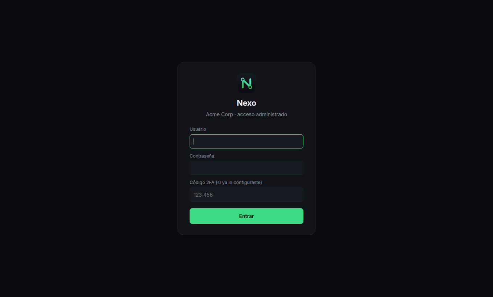

2. **Activa el 2FA**, que es obligatorio: escanea el código con Google Authenticator, Microsoft
   Authenticator o similar, y escribe los 6 dígitos.

   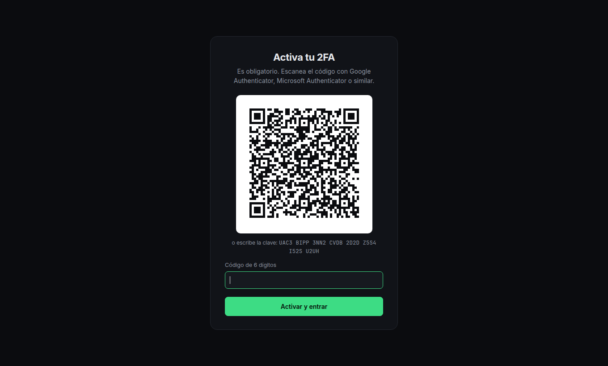

3. Cambia la contraseña temporal por una propia.

### Paso 7 — Cargar los servidores

**Hosts → + Nuevo host**:
- **Nombre:** el que verán los usuarios (`erp-prod`).
- **Dirección y puerto:** cómo llega Nexo Server a ese host.
- **Usuario en el servidor:** la cuenta que usará la puerta (`deploy`, `ubuntu`…).
- **Credencial:** la llave privada (sin frase) o la contraseña. Se guarda **cifrada** y **no se vuelve
  a mostrar**.
- **Grabar sesiones:** sí o no.

La primera conexión fija la huella del servidor. Si después cambia, Nexo rechaza la conexión hasta
que un administrador la revise.

### Paso 8 — Crear usuarios y equipos

- **Usuarios → Nuevo usuario:** se genera una contraseña temporal, que se muestra **una sola vez**.
  Entrégasela a la persona por un canal seguro. En su primer ingreso al panel la cambiará y activará
  su 2FA.
- **Equipos:** agrupa personas (Soporte, Desarrollo, Proveedor X…) para dar permisos en bloque. Los
  miembros se asignan al editar cada usuario.


### Paso 9 — Dar acceso

En la ficha de cada host, **«Dar acceso a»** una persona o un equipo y marca los permisos:

| Permiso | Permite |
|---|---|
| **Terminal** | Sesión interactiva y comandos (grabados) |
| **SFTP** | Transferir archivos |
| **Túneles** | Reenvíos `-L` / `-D`, por ejemplo hacia una base de datos o un panel interno |


---

## 5. Cómo se conectan los usuarios

### Con la app Nexo (recomendado)

1. En la app, icono del **edificio** en la barra izquierda → **Conectar a una organización**.
2. Escribe la URL del panel (`https://nexo.acme.com`), tu usuario, tu contraseña y el código 2FA.
3. Aparecen los hosts que te asignaron, en su propio grupo. Doble clic para entrar; también puedes
   abrir SFTP y dividir la pantalla como con cualquier host.


La sesión de la app dura `NEXO_TOKEN_HOURS` horas (12 por defecto). Después pide de nuevo el 2FA.

### Con cualquier cliente SSH

```bash
ssh  -p 2222 usuario:erp-prod@nexo.acme.com                    # pide contraseña + código 2FA
sftp -P 2222 usuario:erp-prod@nexo.acme.com
ssh  -p 2222 -L 5433:127.0.0.1:5432 usuario:pg-main@nexo.acme.com   # túnel (si tiene permiso)
```

Cada usuario ve sus comandos exactos en la página **Mi acceso** del panel.

---

## 6. Operación diaria: bloquear, auditar, grabaciones

- **Bloquear a alguien:** en *Usuarios* → **Bloquear**. Sus sesiones abiertas se cortan **en ese
  momento** y sus tokens quedan anulados. No hace falta tocar llaves en ningún servidor.
- **Quitar un acceso puntual:** en la ficha del host → **Quitar**.
- **Sesiones:** quién está conectado ahora, desde qué IP y cuánto tráfico movió. Desde ahí puedes
  **cortar** una sesión.
- **Grabaciones:** botón **Ver grabación** para reproducir la terminal tal como la vio el usuario, o
  descargarla en formato `.cast`.
- **Auditoría:** ingresos, intentos fallidos, accesos denegados y cada cambio de administración.

| Sesiones | Grabación |
|---|---|
| 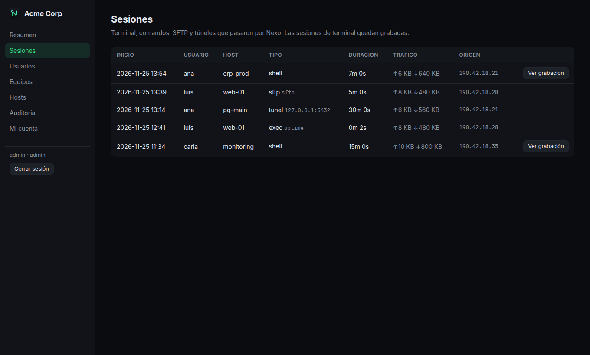 |  |

**Administración por consola** (por ejemplo, si un administrador perdió su teléfono):

```bash
docker compose exec nexo python -m nexo_server create-admin otro_admin
docker compose exec nexo python -m nexo_server reset-2fa usuario
docker compose exec nexo python -m nexo_server unblock usuario
```

---

## 7. Respaldos y actualizaciones

Todo el estado vive en el volumen `nexo-data` (`/data` dentro del contenedor):

| Archivo | Contenido |
|---|---|
| `nexo.db` | Usuarios, equipos, hosts, permisos, sesiones y auditoría |
| `master.key` | Llave que cifra las credenciales. **Sin ella no se pueden recuperar.** |
| `ssh_host_ed25519_key` | Identidad de la puerta SSH. Si cambia, los clientes ven una alerta. |
| `recordings/` | Grabaciones `.cast` |

**Respaldo:**

```bash
docker run --rm -v nexo-data:/data -v "$PWD":/respaldo alpine \
  tar czf /respaldo/nexo-$(date +%F).tar.gz -C /data .
```

Guarda además una copia de `master.key` aparte, en un lugar seguro.

**Actualizar a una versión nueva:**

```bash
cd nexo && git pull
cd server && docker compose up -d --build
```

---

## 8. Referencia: variables y puertos

| Variable | Predeterminado | Descripción |
|---|---|---|
| `NEXO_ORG_NAME` | `Mi organización` | Nombre visible para los usuarios |
| `NEXO_PUBLIC_HOST` | nombre del equipo | Host que la app usará para la puerta SSH |
| `NEXO_PUBLIC_URL` | `http://<host>:8080` | URL pública del panel |
| `NEXO_PUBLIC_SSH_PORT` | `NEXO_SSH_PORT` | Puerto SSH anunciado, si lo publicas en otro puerto |
| `NEXO_SSH_PORT` / `NEXO_HTTP_PORT` | `2222` / `8080` | Puertos internos |
| `NEXO_TRUST_PROXY` | `0` | `1` si está detrás de un proxy (usa `X-Forwarded-*`) |
| `NEXO_TOKEN_HOURS` | `12` | Duración de la sesión en la app |
| `NEXO_WEB_HOURS` | `8` | Duración de la sesión en el panel |
| `NEXO_RECORD` | `1` | Grabar sesiones de terminal (también se elige por host) |
| `NEXO_ADMIN_USER` | `admin` | Nombre del primer administrador |
| `NEXO_MASTER_KEY` | archivo | Llave maestra en base64 (32 bytes). Si no se define, se genera en `/data/master.key` |

| Puerto | Uso | Exponer |
|---|---|---|
| `2222/tcp` | Puerta SSH (app y clientes ssh) | Solo a quienes deban conectarse (VPN o IPs permitidas) |
| `8080/tcp` | Panel web y API | Solo detrás del proxy HTTPS |

---

## 9. Modelo de seguridad

- **Credenciales de los hosts:** cifradas con AES-256-GCM; de solo escritura en el panel; nunca salen
  por la API ni llegan al usuario.
- **Contraseñas de usuario:** con scrypt. El **2FA TOTP es obligatorio** y un mismo código no se acepta
  dos veces.
- **Fuerza bruta:** se limitan los intentos por IP en el panel y en la puerta SSH.
- **Tokens de la app:** temporales, guardados como hash y anulados al bloquear.
- **Huella de cada host destino:** se fija en la primera conexión; si cambia, se rechaza.
- **Panel:** cookies `HttpOnly` y `SameSite=Strict`, CSRF, CSP y protección contra iframes.
- **Contenedor:** usuario sin privilegios; los archivos de `/data` tienen permiso `600`.
- **App:** bóveda AES-256-GCM + scrypt; las llaves privadas solo viven en un agente SSH propio; las
  contraseñas se pasan por variables de entorno, nunca en la línea de comandos.

---

## 10. Limitaciones conocidas

- RDP todavía no pasa por Nexo Server; las conexiones RDP de la app son directas.
- No se permiten reenvíos remotos (`-R`) a través de la puerta.
- Las grabaciones guardan lo que se vio en pantalla, no lo que se tecleó. Así no quedan, por ejemplo,
  las contraseñas que se escriben en `sudo`.
- La llave privada de cada host debe cargarse sin frase de paso; queda cifrada en el servidor.
- La app de escritorio es para Linux.
- Las bases de datos se conectan desde la app (directo o por túnel SSH); Nexo Server todavía no las
  administra ni las graba.

---

## 11. Licencia

Nexo se distribuye bajo la licencia **MIT** (ver [`LICENSE`](LICENSE)).

Incluye componentes de terceros con sus propias licencias:

| Componente | Licencia | Ubicación |
|---|---|---|
| [Bootstrap Icons](https://icons.getbootstrap.com) | MIT | `nexo/bi/LICENSE-bootstrap-icons.txt` |
| [asciinema-player](https://github.com/asciinema/asciinema-player) | Apache-2.0 | `server/nexo_server/static/LICENSE-asciinema-player.txt` |
